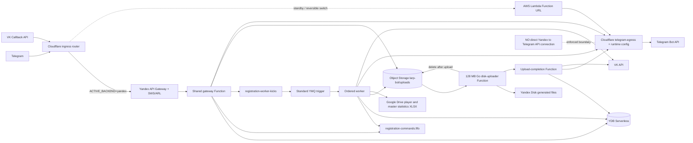
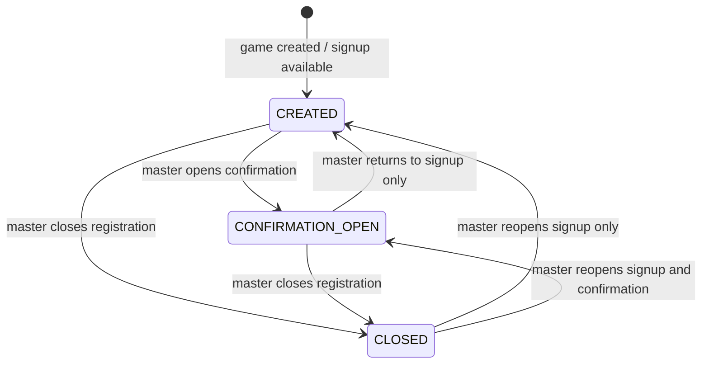
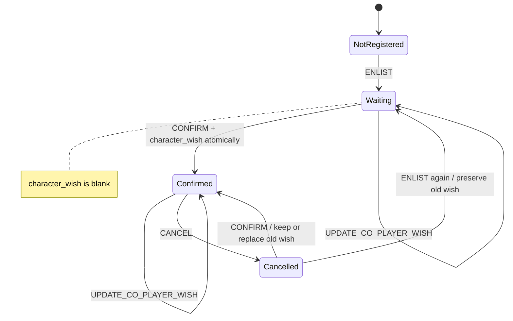
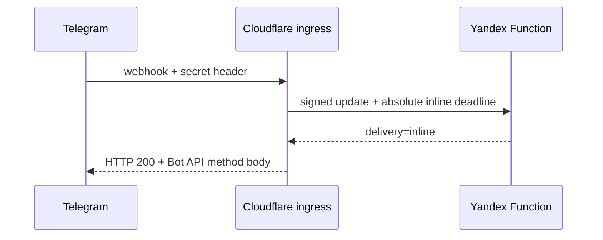
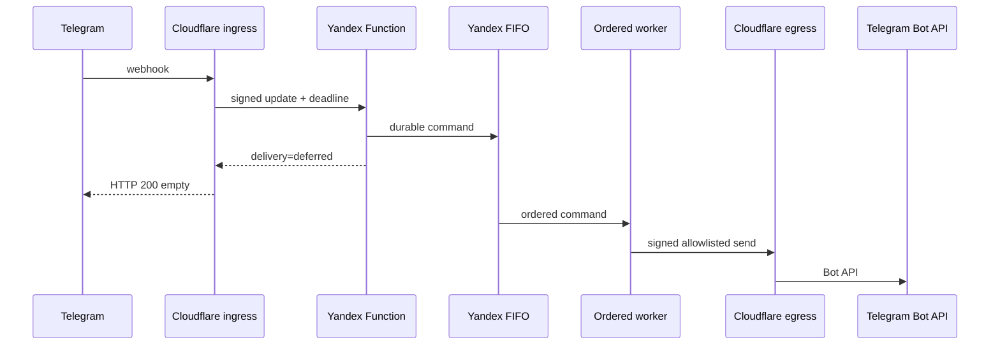

# LARP registration bot

Production-oriented Telegram and VK community bots for LARP profile collection, per-game registration, attendance confirmation, and administration. Both gateways use one Python domain/application layer. Profiles, events, registrations, and per-game masters (stored internally as event leaders) live in five YDB tables; each newly created game owns a restricted master XLSX, a contact-free public XLSX, and a pass table on Yandex Disk.

The default user-facing language is Russian. Python 3.12 and Go 1.23 are required.

## Architecture



The boundaries are:

- `domain`: strict, platform-independent models and invariants;
- `application`: shared conversation state machine and use cases;
- `adapters/telegram` and `adapters/vk`: update parsing/rendering only;
- `adapters/ydb`: authoritative user, event, registration, dialog, and recent-delivery persistence;
- `adapters/yandex_disk`: generated-file rendering, Object Storage staging, and read/delete-only Yandex Disk access;
- `adapters/ymq`: authoritative FIFO publishing, wake-up publishing, and consuming;
- `adapters/runtime_config`: OIDC-authenticated Worker configuration, cached for at most 60 seconds;
- `functions/disk_uploader`: the 128 MB Go function that exclusively uploads and publishes generated files on Yandex Disk, then removes their staged objects;
- `functions/gateway`, `functions/ordered_worker`, `functions/registration_notifier`, and `functions/upload_completion`: Python Yandex entry points; the completion function only persists finished links and sends notifications;
- `cloudflare/telegram-*`: stable Telegram/VK ingress routing and dual-signed
  Telegram egress during the AWS migration.

The old `main.py` was a 286-line Telegram polling script with an in-memory aiogram FSM, one profile workbook, one registration workbook, synchronous mutation, raw Telegram IDs in XLSX, and character wishes collected during enlistment. It has been replaced by a webhook-only Function entry point. Its Russian profile questions and co-player preferences remain the behavioral baseline.

Both bots treat only plain text and keyboard callbacks as conversation input. Stickers, photos, geolocation, audio or music, files, and any other non-text message content receive `Я не буду на это отвечать` without advancing the current dialogue; its keyboard remains available.

## Domain model and character-wish lifecycle

There is deliberately no `character_wish` field on `TelegramUser`, `VkUser`, `tg_users`, or `vk_users`. Pydantic rejects unknown fields, and a contract test prevents this field from being reintroduced.

Every game has exactly three states. Its masters may move it freely between them:



The admin interface names these states `Регистрация`, `Подтверждение`, and `Закрытие регистрации`. Creating a game requires its calendar date before the player capacity: an administrator can enter it in `DD.MM.YY` format or use the primary `Следующая суббота` button, which selects the Saturday one week after the closest upcoming (or current) Saturday according to Moscow time. The nullable `events.game_date` column intentionally leaves archived games created before this rollout undated. Players may enlist in `CREATED` (`Регистрация`) and `CONFIRMATION_OPEN` (`Подтверждение`). They may confirm attendance only in `CONFIRMATION_OPEN`; `CLOSED` (`Закрытие регистрации`) accepts neither enlistment nor confirmation, but players can still cancel their own participation. Existing persisted `OPEN` events are interpreted as `CONFIRMATION_OPEN` during the rollout.

Masters and administrators can change an existing non-archived game's name and date together from its management screen. The update uses the same name limits and strict `DD.MM.YY` date format as creation and runs in the game's FIFO. Its signup token, workbook resource paths, and published workbook URLs remain stable so previously shared links continue to work.

Every newly created game also receives a readable `events.signup_token`: its game-name words are converted to ASCII (Cyrillic letters are transliterated), separated with underscores, followed by the `DD_MM_YYYY` game date and three random alphanumeric characters. Tokens are capped at Telegram's 64-character start-parameter limit; the nullable column keeps older games readable without inventing links for them. The creation result includes a Telegram signup link and a plain VK community chat link. Telegram delivers the token as `/start <token>` so a complete player profile goes straight to that game's signup questions. An incomplete profile entering through a valid Telegram link to a non-archived game starts the profile questionnaire and continues directly into that concrete game's signup dialogue after completion. The VK link uses `https://vk.me/club<group-id>` without a game parameter, so players choose the game through the bot after opening the chat. Every new user receives the greeting and first profile question immediately on start; unknown or archived Telegram tokens are not retained. A scheduled game's Telegram link reports its opening time and returns the player to the main menu until registration is published.

Opening confirmation requires a Moscow-time deadline in `DD.MM.YY HH:MM` format; a master may instead choose the nearest Thursday at 19:00, including the current day. The ordered worker stores the deadline and notifies registrations still in `Ожидается`. These notifications contain one `✅ Подтвердить участие` button that opens the confirmation dialogue for that game directly. The initiating master receives a completion message only after the participant notifications have been delivered. The game-management screen groups this reminder and three master broadcasts under `Уведомления`.

`Уведомить всех игроков` sends master-entered text once to every current `Ожидается` or `Подтверждено` registration, excludes cancelled registrations, and prefixes it with the same game-specific master-message context as confirmed-player information. `Отправить подтвержденным сообщение` sends organization information to every confirmed registration, including the reserve, with that same context. A successful Telegram chat tie stores the permanent invite link and immediately queues that exact link for the first `player_amount` confirmed registrations in signup order; masters never enter a chat URL manually. `Отправить подтвержденным ссылку на чат` remains available as an explicit repeat action with a recipient-count preview. Manually initiated broadcasts require confirmation and notify the initiating master after delivery completes; the automatic tie broadcast needs no second confirmation and likewise reports completion to the tying master.

Every successful signup or confirmation automatically sends the game's masters a message with the player's name, nickname, game/date, and main-roster or reserve position, plus a game-management button. Moderators without the game's leader role do not receive these messages. Mutually linked Telegram/VK master accounts receive one message (Telegram is preferred when both accounts are leaders); players who are also masters do not receive their own activity notification. Per-operation and per-recipient delivery markers are stored in the registration's optional `participation_notification_deliveries_json` column, so retries retain completed recipients even after unrelated messages. Permanently unreachable recipients are marked finished; temporary errors retry without undoing the registration. The participant receives their response before the master notifications are attempted. Delivery is at least once: a crash between sending a message and saving its marker can still cause a duplicate.

Confirmed-player information and chat-link notifications are retained on the event in YDB; the all-player broadcast is not replayed to future signups. Later confirmers receive stored information messages, while stored chat links are replayed only when the player enters the first `player_amount` confirmed registrations. If a cancellation or master removal moves a confirmed reserve player into that group, the worker replays every stored chat link to that player; no per-notification/per-player delivery ledger is maintained, so a player who cancels, signs up again, and reconfirms may receive a link again. The game-management message also gives masters a paginated list of waiting players; selecting one shows whether they registered through the Telegram or VK bot, their VK profile, and their Telegram profile when available. `Убрать не подтвердившихся в запас` keeps every registration but moves all confirmed players above all waiting players in both participant tables. Players crossing into the main roster are notified and receive any stored chat links; waiting players crossing into the reserve receive a separate missed-confirmation notice. Masters may also permanently remove a waiting or confirmed registration through a paginated picker that shows the name captured from the player's profile and the current attendance status. The bot repeats the selected profile name and requires an explicit irreversible-action confirmation before queuing removal. No timer or cron closes confirmation: every later status change remains an explicit master action.



The player main menu shows `Мои игры`, `🎭 Пожелания по игре`, and `❌ Отменить участие` only when the global user has a waiting or confirmed registration for at least one non-archived game. `🎮 Записаться на игру` appears only when a non-archived game has open registration and the user has no active registration for it; a cancelled registration allows signing up again. Mutually linked Telegram/VK accounts share these checks. Profile, confirmation, and administrative-access rules remain unchanged. The menu reads authoritative registration rows in bounded event pages without migrating workbooks or rebuilding showcase tables.

`ENLIST` asks only whom the player wants to play with. The prompt explicitly offers `Пропустить и записаться` and the completion message points players to the later editing flow. An optional nickname is deliberately excluded from first-time profile onboarding and has its own one-step action in the profile edit menu. The public participant workbook shows that nickname when present and otherwise keeps the existing surname-and-name display; the restricted master workbook and pass table continue to use the player's passport name. Co-player coloring treats each comma-separated wish as a case-insensitive pattern, splits it on whitespace, and connects the players when every token is a substring of either the target's surname/name or the target's nickname. A player may register for several games on one date; when another active registration already exists for that date, the co-player-wish prompt warns that only one can ultimately be confirmed. `🎭 Пожелания по игре` lists only the user's waiting or confirmed registrations for non-archived games, opening its two-action game menu immediately when exactly one is available and using five-game pages otherwise. `Мои игры` lists the non-archived games in which the user has a waiting or confirmed registration or is one of the masters, on the same five-game pages, and opens the game page directly when there is exactly one. The game page shows the game name and date, the user's status (master, and/or attendance status with main-roster or reserve position), the game's masters, stored chat links, and the public participant table. Masters are listed by surname and name with a link to the profile on the platform where each of them uses the bot (`https://t.me/<username>` or `https://vk.com/id<id>`); a Telegram master without a public username is listed by name only. The ordered signup and confirmation results end with the same master list and a warning to tell those masters, via their profile links, before skipping the game, because an unannounced no-show can lead to Role Club sanctions. If a long character wish would push the confirmation result past Telegram's 4096 UTF-16-unit message limit, only the echoed wish is shortened; the stored wish stays complete. Chat links are shown only to the game's masters and to confirmed players within the first `player_amount` active registrations, the same players who receive them by broadcast. From there, character wishes retain their existing confirmation-aware behavior, while co-player wishes repeat the signup question and can be replaced or cleared. For every free-text prompt, the bot persists the buttons from its most recent Telegram or VK response and rejects any callback from an older keyboard instead of storing its value as profile, registration, character-wish, co-player-wish, or administrative text. A new YDB row is `Ожидается` with an empty character wish. `CONFIRM` first asks for explicit replacement consent when another game on the same date is already confirmed, then follows the normal character-wish flow. The ordered mutation atomically deletes the replaced registration and writes the new confirmation before regenerating both games' showcases and pass tables. Confirmation commands use a per-player FIFO group so concurrent confirmations cannot bypass the one-confirmed-game-per-date rule. `Без пожеланий` is stored literally, so it remains distinct from “not asked yet.”

The same user has a different deterministic participant key for every event. Registrations are keyed by event in YDB, therefore:

```text
Game A registration.character_wish != Game B registration.character_wish
```

Editing a character wish changes only the character field, operation ID, and timestamp. Editing a co-player wish changes only `wish_play`, operation ID, and timestamp, preserves attendance, and regenerates both participant workbooks so their co-player group colors are recalculated. Cancelling is allowed for every non-archived game, changes only the authoritative status, and removes the player from the public workbook. The ordered worker then notifies every master of the game except the player; the notice names the player and says whether their participation was confirmed (`подтверждено`) or not (`не подтверждено`) before cancelling. A same-day confirmation replacement sends the same notice, as confirmed and with the replacement as its reason, to the masters of the replaced game. Re-enlisting after cancellation updates the wanted co-player preference, returns to `Ожидается`, preserves the old character wish, and resets the signup timestamp so the player appears at the end of the queue. A confirmed user updating that preference stays confirmed. Master removal instead deletes the event registration and its event-specific wishes permanently, then regenerates the master, public, and existing pass tables. If registration remains open, the player can later submit a new registration, but the deleted row cannot be restored.

## Storage

### YDB

Terraform declares exactly these application tables:

| Table | Primary key | Purpose |
|---|---|---|
| `tg_users` | `tg_id` | Telegram profile, optional public nickname, current Telegram handle, mandatory VK URL, YDB privileged role, legacy moderator fallback, FSM/update metadata |
| `vk_users` | `vk_id` | VK profile, optional public nickname, optional Telegram handle, YDB privileged role, legacy moderator fallback, FSM/update metadata |
| `events` | `event_id` | Name, optional game date (required for new games), player capacity, optional registration-opening timestamp, stable master/public registration and pass-table Disk paths/URLs (nullable for legacy games), status, archive timestamp, confirmation deadline, notification/retry metadata, migration timestamp |
| `event_leaders` | `(event_id, platform, platform_user_id)` | Per-game privileged-user leadership membership |
| `registrations` | `(event_id, participant_key)` | Authoritative per-game registration, passport display name and optional public nickname projections, attendance, operation metadata |

The composite registration key makes exact participant lookups constant-cost and keeps every game's rows contiguous for an efficient showcase rebuild. The composite leader key makes repeated grants idempotent and keeps authorization platform-specific. No secondary index or duplicated participant array is maintained. Profile/FSM writes use parameterized YQL and serializable read/write semantics. Event pages are keyset-ordered by `(created_at, event_id)` and never load the complete history just to paginate.

### Generated files

The game-management message includes the saved Google Drive administrative-roster link for the same roles allowed to view game tables, together with the existing do-not-forward warning. If `master_table_google_url` is missing it displays `Ссылка ещё не подготовлена`; opening management never creates or refreshes tables. `Файлы игры` keeps its existing table and achievement actions. Users without table-view access do not receive the administrative link in the management message.

Every new event owns `disk:/larp-bot/events/<uuid>/master_table_<game name>.xlsx`, `disk:/larp-bot/events/<uuid>/public_table_<game name>.xlsx`, and `disk:/larp-bot/passes/<uuid>.xlsx`. File creation is asynchronous: Python renders each generated file and stages it under `larp-bot/uploads/<job-id>/` in private Object Storage. After staging succeeds, the bot sends the pending message before Python invokes the Go uploader with `integration=async`; the gateway request then returns silently. Python never calls the Yandex Disk upload or publish APIs and never waits for those transfers. The 128 MB Go function serializes each destination, streams every staged object to Yandex Disk, publishes new resources, permanently deletes that exact staged-object version after success or a terminal callback failure, and asynchronously invokes the Python completion function. Python rolls back exact staged versions when staging, the pending notification, or a rejected invocation fails before the job is accepted. The completion function persists new links and sends the final message; abandoned staging objects, locks, delete markers, and superseded generation markers also have lifecycle and deployment-cleanup backstops. All three links are included in the eventual creation confirmation sent to the privileged user. The participant workbooks are uploaded and published once, then overwritten in place from the same current YDB registration rows after ordinary mutations, preserving both URLs. Existing events retain their stable original workbook as the master table and receive the missing public table on their next registration refresh or master-only table access. Every press of the game-management action `Выгрузить ачивки` renders the deployment-packaged `pdf_achievements_usual.pdf`, removes every `ЛОГОС` PDF text object before rasterization, and converts the page to a `.pptx` slide with a transparent, centered, one-line `Oswald` game-name box in each original position. Names up to 20 characters retain the source 15-point size; longer names scale proportionally by character count and are rounded down to a quarter point. The first export is published at `disk:/larp-bot/achievements/<uuid>.pptx`; later exports overwrite that resource in place, so the presentation is regenerated while its stored public link remains stable. Registration rows are projected in queue order, initially the first-signup order, with newly registered people at the bottom even if YDB returns rows in an arbitrary order; later profile or attendance updates do not move an existing row. The explicit confirmation-sift action changes that queue order by keeping confirmed signups in their relative order above waiting signups, which likewise retain their relative order. Saving a profile looks up the current or previous normalized full name in the player-attendance statistics instead of asking the player about prior experience, then queues an ordered projection update for every unarchived game in which the user is registered or serves as a master. Adding a game to statistics immediately grants experience to every confirmed participant and queues the same projections. For a game with a tied Telegram chat, statistics addition also checks every Telegram profile known to the bot against the chat and adds active non-administrator members as players, except game masters under either linked identity; this discovery does not add registrations or regenerate the game's master, public, or pass workbooks. These updates refresh each registration's name, contacts, derived experience, and crossplay values before regenerating both participant workbooks and any existing pass table that contains the user. Every game records an explicit player capacity at creation, and its masters can change that capacity later from the game-management screen. A capacity change is processed in the per-game FIFO and regenerates both participant workbooks. Both participant workbooks keep exactly that many numbered main-roster rows directly below the header, pad unused slots, and then keep one merged, centered green `ЗАПАС` row at a fixed position. Further signups appear below it as reserve players. Cancellation, master removal, or a capacity increase closes or moves the separator; every reserve player crossing into the main roster receives one retry-safe notification, and confirmed promoted players also receive stored chat links. Signup completion tells the player whether they are currently in the main roster or how many earlier cancellations are needed, and includes the public-table URL. Pass-table row order is intentionally unspecified. Archiving a game records a separate archive timestamp, closes registration, keeps a management entry visible to admins but not moderators, and retains the game record, registration rows, workbooks, achievements, and URLs. An admin can either unarchive it with registration still closed or permanently delete it after manually entering its exact name. Permanent deletion is available only from the archive and removes the event, its registrations and masters, and all of its participant, pass, and achievement files.

Per-destination Object Storage locks serialize concurrent replacements before they reach Yandex Disk; stale locks are recoverable, and exact-version deletion prevents each normal acquire/release cycle from creating another delete marker.

In both participant tables, comma-separated co-player wishes are matched exactly to displayed surname-and-name pairs and form undirected graph connections. The names in the ten largest connected groups of two or more players receive the Tableau 10 background colors; no other cells, and no pass-table cells, receive those group colors.

Master-table columns:

```text
№
Имя
Профиль ВКонтакте
Профиль в Telegram
Предыдущий опыт в LARP
Готовность к кроссполу
С кем хочу играть
Пожелания по персонажу
Текущий статус
```

The public table contains the same rows but omits `Профиль ВКонтакте`, `Профиль в Telegram`, and `Предыдущий опыт в LARP` entirely. Prior experience is visible only in the restricted master table. There are no technical or hidden columns in either workbook. The participant key, operation ID, and timestamps exist only in YDB. User text beginning with `=`, `+`, `-`, or `@` is prefixed with the established spreadsheet apostrophe escape to prevent formula execution.

The bot only reveals the contact-bearing administrative link to masters of that game, admins, moderator-viewers, and pass managers, and explicitly warns that it must not be shared with players. The separately labeled public link is safe to share with players. Legal/pass names, email, citizenship, raw Telegram IDs, participant keys, operation metadata, and credentials never enter either registration workbook. On first access after rollout, legacy stateful workbooks are imported idempotently into YDB and immediately replaced with the master projection; `events.registrations_migrated_at` prevents later XLSX reads.

Malformed legacy XLSX aborts migration without setting the migration timestamp. After migration, damaged or manually edited showcase files are safely regenerated from YDB on the next mutation.

### Pass profiles and pass tables

Every profile first collects one Cyrillic full-name answer containing surname and name plus an optional patronym, then immediately asks whether a location pass is needed. Name parts are separated only by whitespace, so hyphenated surnames and given names stay intact; the answer must contain exactly two or three Cyrillic parts. Only the normalized surname and name are retained as the profile and non-pass-table display name. Players requesting a pass additionally provide their foreign-citizen choice, one two- or three-part Latin full name when applicable, mobile phone, and email before the common contact and gameplay questions resume. The separately parsed surname, name, and optional patronym are stored in `pass_details_json` in the platform's existing YDB user table and written only to the pass table. A player who requests a pass cannot enlist until every required field is present. Pass profiles saved under the older combined legal-name schema remain readable but are treated as incomplete and must be filled in again before enlistment.

Opening a completed profile shows its name, role, crossplay and pass choices, cross-platform contact, and, when a pass is needed, its phone, email, citizenship, and applicable Latin full name. The profile screen links to a separate edit menu where the whole questionnaire can be repeated or each visible field can be changed independently. Enabling a pass collects all newly required pass fields before saving; disabling it removes the stored pass details. Every completed or cancelled edit returns to the refreshed profile screen.

Russian citizens provide only Cyrillic name fields; their Latin cells are blank. Foreign citizens also provide their full name in Latin. A two-part answer means there is no patronym and is stored as `-` in the unchanged structured pass fields for both scripts.

New games receive a pass table during creation; admins can create one for any legacy game that does not yet have it, and admins or that game's masters can reopen and refresh its stored table links. Moderator-viewers and pass managers can open already-existing links without regenerating them. The pass table contains every active YDB registration (`Ожидается` or `Подтверждено`) whose current YDB profile requests a pass, regardless of whether the player is in the main roster or reserve, plus every master of the game whose current profile requests one. A master does not need a player registration to appear, and a person who is both a player and a master appears only once. Administrators appear under exactly the same membership rule: being a bot administrator alone never adds them to the pass table. Signup, confirmation, cancellation, master-list changes, and master/admin table access regenerate and overwrite the same deterministic resource at `disk:/larp-bot/passes/<event_id>.xlsx`, so its stored public Yandex Disk URL remains unchanged. Both the resource and link remain permanently with the archived game.

Admins and pass managers additionally receive `Получить все пропуска за день` in the main administration menu. With no dated unarchived games the action reports that there is nothing to export; one distinct game date is selected automatically, while multiple dates produce a date picker. The resulting workbook at `disk:/larp-bot/passes/daily-<YYYY-MM-DD>.xlsx` contains each pass-requiring global user at most once across all active registrations and master assignments on that date. Reciprocal Telegram/VK profiles and people registered for several same-day events are deduplicated as one person. Profile edits, signups, and cancellations regenerate the existing date resource without republishing it at a new path, so its public URL remains stable; cancelling one registration keeps the user in the workbook while another active same-day registration remains.

Statistics use exactly two existing binary XLSX files in the Google Drive folder configured by `GOOGLE_FOLDER_ID`: `player_attendance_stats.xlsx` and `master_statistics.xlsx`. Keep exactly one non-trashed statistics file with each name in the folder, and do not rename or replace them. The bot downloads and updates the content of the same statistics file IDs through the existing service-account access, so their names and `webViewLink` values remain permanent while Google Drive retains revision history. On AWS, generated registration and pass XLSX files are created or updated in the same folder through the owner-executed, HMAC-signed Apps Script gateway under stable path-derived names and shared for link access before Yandex Disk is attempted. The gateway is restricted to `events — *.xlsx` and `passes — *.xlsx`; deployment instructions are in [`integrations/google-drive-apps-script`](integrations/google-drive-apps-script/README.md).

AWS also exports the complete production DynamoDB database every six hours, at 00:00, 06:00, 12:00, and 18:00 in `Europe/Moscow`. The file is the same canonical JSON document used for the YDB-to-DynamoDB migration; only the top-level `exported_at` value is rendered with a `+03:00` offset instead of UTC `Z`. Each run replaces `rolebot-database-snapshot.json` in place on Google Drive and `disk:/larp-bot/rolebot-database-snapshot.json` on Yandex Disk, preserving one public file ID/link per platform. The first successful links are locked in free Standard Parameter Store values at `/larp-bot/production/database-snapshot-google-url` and `/larp-bot/production/database-snapshot-yandex-url`; a missing file or changed URL fails closed. Both destinations are attempted independently, and any export, upload, link-persistence, or link-stability failure sends a high-priority ntfy alarm. A Google Drive failure fails the Lambda invocation for Scheduler retry and the existing CloudWatch alarm path. Yandex Disk gets five bounded attempts, then remains best effort: its failure sends the direct ntfy alarm and keeps the persisted permanent URL available without overriding the successful authoritative Google snapshot.

Configured administrators see one `Управление статистикой` entry. Its submenu contains:

- `Ссылки на таблицы статистики`: returns labeled permanent Google Drive links for both the player-attendance and master-participation workbooks.
- `Добавить игру в статистику`: opens a paginated picker containing only unarchived games. Selecting a game shows a separate warning and requires explicit confirmation; a stale confirmation button cannot queue the action. After confirmation, the same FIFO operation adds a `game name (DD.MM.YY)` column to both workbooks; an undated legacy game retains only its existing name. The player workbook writes `1` for confirmed registrations; waiting and cancelled registrations are excluded because the bot has no separate check-in status. The master workbook writes `1` for every current event leader, including a leader who is not registered as a player. Player names come from the registration's Cyrillic surname-and-name snapshot, while master names come from their current profiles; patronyms are omitted. Matching ignores case, extra whitespace, and the difference between ё/е. If a player row contains exactly two valid Cyrillic name parts, the player workbook also tries them in reverse order after an exact match fails. Missing people are appended before the summaries; matching duplicate rows are all marked.

The season is derived at processing time in Moscow: September through December belongs to the season starting that calendar year, while January through August belongs to the season starting the previous year. Thus September 2026 through August 2027 is `2026-2027`. For each workbook, the editor uses the latest seasonal sheet if it is current; otherwise it appends a new current-season sheet based on the latest list, carrying names, lifetime totals, milestone flags, styles, and conditional-formatting rules while leaving every older worksheet part intact. Both revisions are fully parsed and staged before either file is uploaded. Each workbook independently skips a game-name column that already exists in its current season, so retries safely complete a partially interrupted two-file update without duplicating the game in either table.

All statistics commands use the same FIFO group, `statistics`, across games and platforms. Both the gateway and ordered worker enforce administrator authorization, and the worker rechecks that the selected game is still unarchived. No new YDB tables are required.

See [the supplied workbook analysis](docs/attendance-statistics.md) for colours, formulas, known template issues, and preservation details.

The pass workbook copies the venue template's header wording and theme-color fill exactly:

```text
Фамилия (Кириллицей)
Имя (Кириллицей)
Отчество (Кириллицей)
Иностранный гражданин (Да/Нет)
Фамилия (Латиницей)
Имя (Латиницей)
Отчество (Латиницей)
Телефон
E-mail
```

The fourth column is always `Да` or `Нет`. Because these public links contain legal identity and contact data, access and sharing must be restricted operationally to the venue and authorized organizers.

## FIFO ordering and failure behavior

All conflicting operations use `registration-commands.fifo` with:

```text
MessageGroupId = event_id
MessageDeduplicationId = operation_id
```

An operation ID is a deterministic UUID for one platform update. Each affected participant row also stores `last_operation_id`. Retry therefore does not logically reapply the mutation. Master removal of a player is naturally idempotent at the registration key: a retry after deletion still regenerates every derived table, covering failures that happen between the authoritative delete and workbook replacement.

Yandex currently permits a native Message Queue Function trigger only for a standard queue. The intentional bridge is:

```text
FIFO command queue
    |
    | native Function trigger cannot consume FIFO
    v
standard kick queue
    |
    v
native YMQ Function trigger
    |
    v
bounded ordered FIFO drainer
```

Do not attach the trigger directly to FIFO unless Yandex officially adds support and this architecture is deliberately migrated. The kick has no business-ordering role. The publisher first makes the FIFO command durable, then emits a kick. If kick publishing fails, the platform retry uses the same operation ID: FIFO deduplicates the command while the retry emits another kick.

YDB, file-rendering, Object Storage staging, or async-enqueue failures leave the FIFO message undeleted. Once the Go invocation is accepted, the Python worker can acknowledge FIFO without waiting for Yandex Disk; the Go function owns transfer retries and generation ordering from that point. Before the worker fails its standard-queue kick, it resets every failed FIFO receipt's visibility to zero; the trigger retry can therefore see the authoritative command immediately instead of acknowledging an apparently empty FIFO while the command remains invisible. A YDB mutation is authoritative even if showcase generation or bot delivery fails; retrying the same operation ID restages the latest projection without logically reapplying the mutation. The delivery marker is written only after the transport accepts the response. One exception keeps a single person from stalling a game: when Telegram or VK refuses a recipient permanently—the person blocked the bot, deleted their account, or forbids community messages—that recipient is logged as `notification_recipient_unreachable`, recorded in the retry snapshot as done, and skipped, because every retry would repeat the same rejection while the command held its FIFO message ahead of every later command for that game. The recognized rejections are Telegram `bot was blocked by the user`, `user is deactivated`, `chat not found`, and `bot can't initiate conversation with a user`, plus VK error codes 901 and 902; every other rejection, including an egress-Worker authentication failure or a malformed message, still fails the command and is retried. Participant notifications resolve private Telegram/VK recipients by comparing the existing per-event HMAC participant keys, and every notification identifies a dated game as `«name» (DD.MM.YY)`. Confirmation-open and reminder messages select only `Ожидается` registrations. Organization-information broadcasts select every `Подтверждено` registration; standalone chat links select only the first `player_amount` confirmed registrations in signup order. Both are appended to the event's plain notification list. A later confirmation replays information notifications and, when the player is in the confirmed-player limit, stored chat links. Cancellation, master removal, and same-day confirmation replacement persist a retry-safe snapshot of the one newly eligible confirmed link recipient. Cancellation also saves the player's pre-cancellation status in the per-event removal snapshot and records each notified master there, so a retry still reports that status and never notifies a master twice. A same-day replacement runs in the per-player group, so it cannot use that snapshot; it skips a master whose last delivery is already its notice. The confirmation-sift operation stores a retry-safe snapshot of every promotion and demotion across the main-roster boundary so partial notification delivery can resume without duplicates. Because confirmations use per-player FIFO groups, players can confirm while a sift retry waits in its per-event group: a retry that still has to move players adds those moves to the snapshot, and every saved move is rechecked against the current roster before it is counted or notified. Master status changes, reminders, broadcasts, archival, and ordinary participant mutations share their per-event FIFO group; confirmation decisions instead share a per-player FIFO group across games. The worker rechecks the command author's current internal YDB event-leader membership before applying any of them. Worker-time YDB state—not an earlier button or XLSX content—is authoritative.

## Telegram transport

Fast path:



Deferred ordered path:



Ingress accepts only POST, caps the body at 256 KiB, validates `X-Telegram-Bot-Api-Secret-Token`, drops updates from senders over the per-user limit (see [Rate limiting and abuse protection](#rate-limiting-and-abuse-protection)), and signs timestamp, request ID, method, path, and body hash. Defaults are a 1500 ms backend inline cutoff and 2500 ms ingress hard deadline. If Yandex starts after its deadline, it selects egress. If ingress reaches its hard deadline, it acknowledges Telegram with empty HTTP 200 while observing the already-started upstream request. Durable registration correctness exists only in Yandex FIFO, never in `waitUntil()`.

Egress accepts only `/telegram/send`, a ±60 second signature, a matching request ID, and the explicit Bot API method allowlist needed for message delivery and chat management. It constructs the Bot API URL itself. One logical answer is either inline or egress-delivered, never intentionally both.

## VK transport

VK Callback API posts directly through API Gateway/SWS to the same gateway Function. The handler checks group ID and callback secret on every request. `confirmation` returns the configured confirmation string immediately. Other supported callbacks return `ok`; outbound messages use `messages.send` with a deterministic `random_id`. Telegram handle is optional and normalized to `@username` when present.

## Security model

- Every Telegram Cloudflare→Yandex request and Yandex→Cloudflare egress request uses HMAC-SHA256 with timestamp freshness and body integrity.
- Runtime Functions exchange their platform-provided IAM credentials for one-hour Yandex OIDC ID tokens. The egress Worker verifies the Yandex signature, exact audience, expiry, and an allowlist containing only the gateway, ordered-worker, and disk-uploader service accounts before returning runtime configuration.
- Admin IDs are JSON numeric arrays in the Worker configuration, cached no longer than 60 seconds. Every privileged action rechecks authorization.
- Privileged roles form a strict hierarchy: moderator (`gamemaster` internally), moderator-viewer (`gamemaster_viewer`), pass manager (`pass_manager`), then admin. Every higher role includes all lower-role capabilities. Pass-manager-specific actions are reserved for a later rollout; its distinct higher rank is already persisted and enforced.
- A moderator who creates a game becomes its master; an admin who creates a game chooses whether to master it or to pick another privileged user as its first master. Masters can also be added explicitly later; configured admins are not copied into unrelated games.
- Masters and bot administrators can change status, send participant notifications, remove waiting or confirmed players, open the three event-table links, manage the game's masters, or archive that event. All privileged users can create games. Moderator-viewers and pass managers can inspect participant profiles, waiting players, masters, and existing table links for any non-archived game without being its master; they can also generate or reopen that game's achievement presentation. Base moderators need per-game master membership for those details and all mutations. Admins can browse and fully control every game without master membership.
- Event IDs and participant state are reloaded server-side; callback values are never trusted as authorization.
- Profile/pass data stays in private YDB and structured logs omit request bodies, email, legal names, and credentials.
- Smart Web Security in API mode and Advanced Rate Limiter enforce a configurable global 10 requests/second. It is intentionally not grouped by Cloudflare source IP. The ingress Worker additionally limits each Telegram user; see [Rate limiting and abuse protection](#rate-limiting-and-abuse-protection).
- Function scaling defaults to three instances per function, one request per instance.
- All application secrets are installed as encrypted Worker bindings with `wrangler secret bulk` after Terraform. Yandex Functions receive only non-secret endpoint and identity configuration; secret values exist only in Worker bindings and short-lived Function memory.
- `.env*`, state, plans, build output, Wrangler state, and Python/Node caches are ignored.

## IAM

Terraform creates separate gateway, ordered-worker, disk-uploader, kick-trigger, API-Gateway, and YMQ-client service accounts.

| Identity | Roles/purpose |
|---|---|
| gateway | `ydb.editor`, stages generated files, and invokes only the disk uploader; can mint an OIDC token only for its own service account |
| ordered worker | `ydb.editor`, stages generated files, invokes the disk uploader, and runs the completion callback; can mint an OIDC token only for its own service account |
| disk uploader | reads and deletes staged objects, writes generation markers, invokes only upload completion, and can mint an OIDC token only for itself |
| YMQ client key owner | `ymq.reader`, `ymq.writer` |
| kick/async trigger | `ymq.reader`; folder-scoped `functions.functionInvoker` is required to bootstrap async-enabled Function versions, with explicit per-function bindings retained for the application call paths |
| API Gateway | invokes only gateway Function |

Runtime Functions do not receive `admin` or `editor`. The deployment identity needs service-specific infrastructure administration, IAM-binding permissions, and read access to the private Function-package bucket; scope it to the production folder.

## Local development

For YDB usage investigations, see [operation metrics and read amplification](docs/ydb-operations.md).
For a capability-oriented source index, see the [code map](docs/code-map.md).

```bash
python3.12 -m venv .venv
.venv/bin/python -m pip install --upgrade pip
.venv/bin/python -m pip install -e '.[dev]'
.venv/bin/ruff format --check .
.venv/bin/ruff check .
.venv/bin/mypy
.venv/bin/pytest
python scripts/check_storage_constraint.py
bash scripts/check_telegram_isolation.sh
```

Workers:

```bash
cd cloudflare/telegram-ingress
npm ci
npm run typecheck
npm test
npm run build

cd ../telegram-egress
npm ci
npm run typecheck
npm test
npm run build
```

Build the deterministic Function ZIP:

```bash
bash scripts/build_function.sh
```

Build the deterministic Go uploader source ZIP:

```bash
bash scripts/build_disk_uploader.sh
```

The Python package uses a fully pinned Python 3.12 runtime dependency closure. Both ZIP writers fix entry order, timestamp, mode, and compression settings.

## GitHub Actions setup

Create protected `production` and `production-plan` environments. Configure a Yandex Workload Identity OIDC federation with:

```text
issuer:   https://token.actions.githubusercontent.com
jwks:     https://token.actions.githubusercontent.com/.well-known/jwks
audience: https://github.com/ProfessorLayton322
subjects:
  repo:ProfessorLayton322@78860133/rolebot-hse@1341141222:environment:production
  repo:ProfessorLayton322@78860133/rolebot-hse@1341141222:environment:production-plan
```

This repository was created after GitHub enabled immutable OIDC subjects for new repositories, so the owner and repository IDs are required. An old username that merely redirects on github.com will not match the OIDC claim. Link both exact subjects to the dedicated deployment service account. If GitHub OIDC customization is changed later, the exchange step prints the exact subject that must be linked. The workflows exchange GitHub's short-lived OIDC token at `https://auth.yandex.cloud/oauth/token`; no Yandex authorized-key JSON is needed in GitHub.

### Required GitHub Secrets

These names are exhaustive for the supplied workflows:

| Secret | Where used / how to obtain |
|---|---|
| `CLOUDFLARE_API_TOKEN` | Cloudflare token with Account Workers Scripts edit/deploy and account read permissions |
| `TF_STATE_ACCESS_KEY_ID` | Static S3 access-key ID for the pre-created private Yandex Object Storage bucket; used for Terraform state and Function-package uploads |
| `TF_STATE_SECRET_ACCESS_KEY` | Matching S3 secret key; it must be allowed to read and write the Function-package object prefix |
| `TG_BOT_TOKEN` | BotFather token; installed only in telegram-egress and used by deployment to call `setWebhook` |
| `TG_WEBHOOK_SECRET` | Random webhook secret using only `A-Z a-z 0-9 _ -`; installed in ingress and passed to `setWebhook` |
| `YANDEX_DISK_TOKEN` | OAuth token for the dedicated Disk account/folder |
| `GOOGLE_SERVICE_ACCOUNT_JSON` | Google credential JSON used only to read and update the two existing statistics workbooks; the current service account remains sufficient for those existing files |
| `GOOGLE_APPS_SCRIPT_HMAC_SECRET` | At least 32 random bytes encoded as text; must exactly match the Apps Script `ROLEBOT_HMAC_SECRET` property and is installed only in AWS SSM |
| `VK_ACCESS_TOKEN` | VK community access token with messaging permission |
| `VK_CALLBACK_SECRET` | Random secret configured identically in VK Callback API |
| `VK_CONFIRMATION_STRING` | VK's server-confirmation string |
| `VK_GROUP_ID` | Numeric community ID; treated as protected configuration |
| `PARTICIPANT_KEY_HMAC_SECRET` | At least 32 random bytes, high-entropy; rotation changes lookup keys and requires a migration |
| `CF_TO_YANDEX_HMAC_SECRET` | At least 32 random bytes; installed in ingress and the egress runtime-config Worker |
| `YANDEX_TO_CF_EGRESS_HMAC_SECRET` | At least 32 random bytes; installed in the egress Worker and provided to authenticated Yandex runtimes |
| `CF_TO_AWS_HMAC_SECRET` | At least 32 random bytes; installed in ingress and in AWS SSM by the AWS deployment workflow |
| `AWS_TO_CF_EGRESS_HMAC_SECRET` | At least 32 random bytes; installed in egress and in AWS SSM by the AWS deployment workflow |

The YMQ access key is generated by Terraform and copied directly to the egress Worker by `deploy.yml`; do not create `YMQ_ACCESS_KEY_ID` or `YMQ_SECRET_ACCESS_KEY` GitHub Secrets. `YANDEX_BACKEND_URL`, the runtime-config URL/audience, and allowed Yandex service-account IDs are Terraform outputs or derived values injected into Workers and Functions; none is a GitHub Secret.

Generate secrets locally without printing them into shell history:

```bash
openssl rand -hex 32       # each HMAC secret
openssl rand -hex 24       # Telegram webhook secret (allowed character set)
```

### Required GitHub Variables

| Variable | Meaning |
|---|---|
| `YC_CLOUD_ID` | Production Yandex cloud ID |
| `YC_FOLDER_ID` | Production folder ID |
| `YC_WIF_AUDIENCE` | Audience configured on the Yandex workload identity federation; must match exactly |
| `YC_DEPLOY_SERVICE_ACCOUNT_ID` | Deployment SA linked to the GitHub subject |
| `CLOUDFLARE_ACCOUNT_ID` | Cloudflare account ID |
| `CLOUDFLARE_WORKERS_SUBDOMAIN` | Account subdomain without `.workers.dev` |
| `TF_STATE_BUCKET` | Existing private versioned Object Storage bucket name; Function packages are stored under `larp-bot/functions/` in the same bucket, where a prefix-scoped lifecycle retains three non-current packages and expires older ones after one day |
| `GOOGLE_FOLDER_ID` | Google Drive folder containing the permanent statistics files and generated XLSX mirrors |
| `GOOGLE_APPS_SCRIPT_URL` | Deployed owner-executed Apps Script web-app URL ending in `/exec`; configure it in both `production` and `production-plan` |
| `TG_ADMIN_IDS` | Public JSON array of numeric Telegram user IDs, e.g. `[12345678]` |
| `VK_ADMIN_IDS` | Public JSON array of stable numeric VK user IDs, e.g. `[87654321]`; resolve vanity handles before adding them |
| `TG_GAMEMASTER_IDS` | Public JSON array of Telegram moderator user IDs; moderators have privileged read access and can mutate games where they are masters |
| `VK_GAMEMASTER_IDS` | Public JSON array of stable numeric VK moderator user IDs; moderators have privileged read access and can mutate games where they are masters |
| `ACTIVE_BACKEND` | Cloudflare selector: `yandex` during standby, later `maintenance` or `aws` only under the migration runbook |
| `AWS_BACKEND_URL` | Stable AWS Lambda Function URL emitted by the AWS application Terraform root |

### OIDC-protected runtime configuration

`deploy.yml` installs these values as encrypted `telegram-egress` Worker bindings. The `/runtime/config` route returns the subset needed by Yandex only after verifying a Yandex-signed OIDC ID token:

```text
YANDEX_DISK_TOKEN
GOOGLE_SERVICE_ACCOUNT_JSON
VK_ACCESS_TOKEN
VK_CALLBACK_SECRET
VK_CONFIRMATION_STRING
VK_GROUP_ID
TG_BOT_USERNAME
TG_ADMIN_IDS
VK_ADMIN_IDS
TG_GAMEMASTER_IDS
VK_GAMEMASTER_IDS
PARTICIPANT_KEY_HMAC_SECRET
CF_TO_YANDEX_HMAC_SECRET
YANDEX_TO_CF_EGRESS_HMAC_SECRET
YMQ_ACCESS_KEY_ID
YMQ_SECRET_ACCESS_KEY
```

### Cloudflare Worker bindings

`telegram-ingress` non-secret bindings owned by the Yandex/Cloudflare Terraform
root:

```text
ACTIVE_BACKEND
YANDEX_BACKEND_URL
AWS_BACKEND_URL
```

`telegram-ingress` encrypted secrets installed by the pinned Wrangler command:

```text
TG_WEBHOOK_SECRET
VK_CALLBACK_SECRET
VK_CONFIRMATION_STRING
VK_GROUP_ID
CF_TO_YANDEX_HMAC_SECRET
CF_TO_AWS_HMAC_SECRET
```

`telegram-egress`:

```text
TG_BOT_TOKEN
TG_BOT_USERNAME
YANDEX_TO_CF_EGRESS_HMAC_SECRET
AWS_TO_CF_EGRESS_HMAC_SECRET
YANDEX_DISK_TOKEN
GOOGLE_SERVICE_ACCOUNT_JSON
VK_ACCESS_TOKEN
VK_CALLBACK_SECRET
VK_CONFIRMATION_STRING
VK_GROUP_ID
TG_ADMIN_IDS
VK_ADMIN_IDS
TG_GAMEMASTER_IDS
VK_GAMEMASTER_IDS
PARTICIPANT_KEY_HMAC_SECRET
CF_TO_YANDEX_HMAC_SECRET
YMQ_ACCESS_KEY_ID
YMQ_SECRET_ACCESS_KEY
YANDEX_OIDC_AUDIENCE
YANDEX_SERVICE_ACCOUNT_IDS
```

`TG_BOT_USERNAME` is not a separately managed GitHub value. During deployment, the AWS parameter step and `scripts/update_cloudflare_secrets.sh` resolve it from Telegram's authenticated `getMe` response. AWS stores it in the narrowly scoped Standard SecureString used by link-rendering Lambdas, while Cloudflare installs it with the other egress bindings so the Yandex application can render direct bot links without receiving `TG_BOT_TOKEN`.

## First deployment

1. Create the Telegram bot, VK community, dedicated Yandex Disk OAuth token, Google service account, Cloudflare account, and active Yandex billing folder. Put `player_attendance_stats.xlsx` and `master_statistics.xlsx` in the configured Google Drive folder and grant that service account edit access without replacing either file later.
2. Create a private, versioned Object Storage bucket for Terraform state. Create a dedicated state service-account static S3 key and put its two parts in `TF_STATE_*` GitHub Secrets.
3. Create a Yandex deployment service account with service-specific roles needed to manage IAM accounts/bindings, Functions, API Gateway, YDB, YMQ, Logging, and Smart Web Security, plus `storage.viewer` for the private Function-package bucket. Do not reuse a runtime account.
4. Create the GitHub OIDC workload identity federation and federated credentials for the exact `production` and `production-plan` environment subjects. Add the GitHub Variables above, leaving `ACTIVE_BACKEND=yandex` until the cutover runbook reaches its routing step.
5. Add all GitHub Secrets above to the protected `production` environment. Mirror non-deployment credentials needed for plan into `production-plan` (`CLOUDFLARE_API_TOKEN` and both state keys).
6. Run CI on a pull request. Review `plan.yml`, especially IAM bindings, five YDB tables, and public Worker endpoints.
7. Merge to `main`. The serialized deployment tests, builds, applies Terraform, injects every application secret into Workers, calls Telegram `setWebhook`, and runs live Telegram/VK smoke tests.
8. In VK community settings, add the emitted `vk_callback_url`, set the same callback secret, select the current API version, confirm the server using `VK_CONFIRMATION_STRING`, and enable message events.
9. Send `/start` to Telegram and a message to the VK community. Create a test game as an admin, verify the returned master link carries the no-sharing warning, open the contact-free public workbook, enlist while confirmation is unavailable, change its Статус to `Подтверждение`, confirm with a wish, change it to `Закрытие регистрации`, and verify signup and confirmation are unavailable.
10. Verify YDB contains `tg_users`, `vk_users`, `events`, and `registrations`; verify the Telegram webhook points to `*.workers.dev`, never the Yandex gateway.

## Telegram setup details

The deployment runs:

```text
setWebhook(
  url=<Cloudflare ingress URL>,
  secret_token=<TG_WEBHOOK_SECRET>,
  allowed_updates=[message, callback_query, my_chat_member, chat_member],
  max_connections=5,
  drop_pending_updates=false
)
```

To inspect without exposing the token, call `getWebhookInfo` from a protected operator shell. Expected URL: Cloudflare ingress. Polling and `getUpdates` are not production options.

Give the bot the invite, promote, and restrict-member rights needed for link creation, identity titles, and cancellation removal. When the bot first gains administrator send access it posts the paginated non-archived-game picker. Only a configured bot admin or a master of the selected game may bind it; moderators without that game-specific assignment cannot invoke `/tie`. A game master sees only their assigned games, while a bot admin sees every unarchived game. The person must also own the chat or be a Telegram administrator with at least one explicit privilege; title-only player administrators cannot tie chats. A successful tie stores the chat ID and the bot-owned primary invite link in YDB, queues that link for the confirmed main roster through the ordered worker, deletes the picker, and never exports or invalidates another link for that binding. Registered users joining the tied chat are promoted with no explicit privileges and receive a Russian `Имя Фамилия` title within Telegram's 16-character limit. The given name is kept in full while the surname is shortened to its initial with a period when needed (for example, `Анастасия С.`); an exceptionally long given name is shortened with an ellipsis and followed by the surname initial. Cancelling a confirmed participation removes that Telegram profile from the tied chat while leaving the permanent invite reusable for a later valid confirmation.

## VK setup details

Use the Terraform `vk_callback_url`, numeric `VK_GROUP_ID`, matching `VK_CALLBACK_SECRET`, and the generated `VK_CONFIRMATION_STRING`. The URL is the stable Cloudflare `/vk` route and does not change when the backend selector changes. Enable community messages and `message_new`. A `confirmation` request must return only the confirmation string; authenticated normal callbacks receive `ok`.

## Privileged-role and master management

Admin role assignment remains exclusively in the public GitHub Actions repository variables `TG_ADMIN_IDS` and `VK_ADMIN_IDS`; it is independent of each event's internal YDB leader membership. Removing an administrator from an event's master list therefore never removes any global admin capability. The existing `TG_GAMEMASTER_IDS` and `VK_GAMEMASTER_IDS` variables remain supported as deployment-configured moderator lists. Values in all four variables are JSON arrays of stable numeric platform IDs, and empty moderator variables are represented as `[]`. Changing a variable requires rerunning `deploy.yml`; the workflow replaces the Worker bindings and warm Functions refresh within 60 seconds.

Admins can choose `Управление ролями` in either bot to appoint a moderator, moderator-viewer, or pass manager, remove an assigned role, or browse privileged users. Telegram assignment accepts `@username`, a public `t.me`/`telegram.me` profile URL, or the equivalent VK-rendered mention. VK assignment accepts an `https://vk.com` or `https://vk.ru` profile URL and resolves vanity names to the stable numeric VK ID. The target must already have messaged the selected bot and completed that bot's profile. For Telegram profiles created before username persistence was introduced, the bot recovers an unambiguous identity from prior registration history and backfills the current handle; a user with no recorded handle or registration must send the bot a new message first. Successful grants store the exact internal `privileged_role` and keep `is_gamemaster` true for backward compatibility. A nullable role falls back to the legacy boolean, so existing production moderators retain access before their next explicit role assignment. Deployment-configured moderator sets are combined with persisted roles during authorization. Role lists and removal pickers are paginated, selecting a listed user opens their available Telegram and VK profiles, and the affected user receives a notification after assignment or removal. Game creation asks for the name and then requires an integer player capacity before it creates either workbook. A master can later change the capacity from that game's management screen.

Every privileged request rechecks both the latest environment role sets and the user's YDB role. Any privileged user can create a game. A non-admin creator becomes the new game's only master, while an admin chooses whether to become master, pick another privileged user, or assign one later. The picker includes moderators, moderator-viewers, pass managers, and administrators and also accepts a direct Telegram/VK profile. Admins and pass managers alone also see the date-wide pass export in the main administrative menu. If a directly entered master profile belongs to a regular user, the bot asks whether to promote them to moderator immediately; declining cancels the assignment and returns to choosing another person, while accepting grants the moderator role and continues with that person as the game's only master. The final creation question offers immediate publication or delayed registration opening. A delayed opening accepts strict `DD.MM.YY HH:MM` Moscow time with `00` minutes or the nearest future Friday at 18:00; until that instant, the game remains available to its masters but is absent from player-facing registration lists, and both stale signup callbacks and token links are rejected with the scheduled opening time. All timer-fired lifecycle actions (registration opening, confirmation opening, and automatic closing) use whole-hour times. The lifecycle function runs hourly and dispatches all actions scheduled before the end of its five-minute window together, while retaining overdue actions for safe retries. The game, token, and workbooks are created only after this choice, and the creation response includes a ready-to-share Telegram signup link and VK community chat link. A retried notification finishes the same game instead of creating another. No other administrator is included automatically. `Управление играми` shows only non-archived games in reverse chronological order. Admins can open archived games through the separate `Архив игр` button and unarchive them from their management screen; lower roles cannot list, open, or unarchive archived games, including through stale management buttons. Unarchived games return to `Управление играми` with registration closed. All paginated button lists show at most five objects per page, conditionally offer `Назад` and `Вперёд`, and always offer `Отмена` to return to the parent menu. Selecting an active game opens one management screen containing its status and permitted game-specific actions. For administrators, that screen also offers `Добавить игру в статистику`, which first requires explicit confirmation and then runs the same administrator-only global-statistics FIFO action as the picker in `Управление статистикой`. Its separate `Мастера` screen can add a privileged user from a paginated picker or a direct Telegram/VK profile, remove an appointed master through a paginated picker, and browse a paginated master list with Telegram/VK profile details. A directly entered regular-user profile triggers the same promote-and-add confirmation instead of being rejected; the promotion and both user notifications are retry-safe. An administrator who is not on the list also gets a one-step action to add themselves. A privileged user receives a notification whenever they are added to or removed from a game; the addition notification includes a button that opens that game's management screen directly. `🗑 Удалить игрока` labels every button with the profile name and status and repeats that name in a final irreversible-action warning. `📋 Список профилей игроков` pages through every registered and confirmed player, in the main roster or in reserve, with the same name-and-status labels; selecting one shows the player's profile in the format of the `📝 Профиль` button, with both Telegram and VK contacts, followed by the game, the registration status, main roster or reserve, and the bot the player uses. Moderator-viewers and pass managers get this read-only view, the waiting-player list, the master list, and existing table links even when unassigned. They cannot create or repair missing per-game workbooks; opening `Таблицы участников и пропусков` does that only for a game master or admin. Status and player-capacity changes, reminders, notifications, player removal, master changes, per-game workbook creation, and archival still require either event-master membership or the global admin role, including through stale buttons and queued commands; unarchival requires a global admin. Completed actions provide a `Назад` button to return to their parent menu (or to the game list after archival). The separate `Уведомления` screen contains the confirmation reminder, `Отправить подтвержденным ссылку на чат`, and `Отправить подтвержденным сообщение`; both confirmed-player branches validate up to a 4000-character final message and show a recipient-count/message preview before queueing. Archival requires the exact case-sensitive game name after trimming outer whitespace. Archived games are distinguished from games whose registration is merely closed. Player signup, cancellation, and character- or co-player-wish editing reject archived games both before queueing and again in the ordered worker.

## Secret rotation

- Rotate Telegram/VK/Disk tokens in their provider first, update GitHub Secrets, then redeploy.
- Rotate each backend's ingress/egress HMAC pair in a coordinated deploy because both ends must match. During migration the egress Worker deliberately accepts the separate Yandex and AWS signatures; it does not accept old and new values for either backend.
- Rotate `TG_WEBHOOK_SECRET` by updating GitHub and redeploying; the workflow injects ingress before calling `setWebhook`.
- Rotate the Terraform-state key at least every 90 days and update both `TF_STATE_*` secrets.
- Rotate the Terraform-managed YMQ key by replacing `yandex_iam_service_account_static_access_key.ymq_client`; the deployment copies the new value to the Worker before normal traffic should resume.
- Do not casually rotate `PARTICIPANT_KEY_HMAC_SECRET`: existing YDB registration rows become undiscoverable. Plan a migration that rewrites all participant keys first.

Worker binding updates create a new encrypted Worker version; Yandex runtimes never pin a binding version.

## Terraform resources

Terraform manages:

- five least-purpose service accounts, runtime IAM and invocation bindings;
- the pre-created deployment bucket's Function-package lifecycle, without expiring any Terraform-state versions;
- one Serverless YDB database and five application tables;
- one FIFO command queue and one standard kick queue;
- gateway and ordered-worker Functions, versions, logging, and scaling policies;
- one standard-queue Function trigger (never a FIFO trigger);
- one API Gateway with two POST routes;
- Smart Web Security and Advanced Rate Limiter profiles;
- two Cloudflare Worker objects, versions, deployments, and workers.dev bindings, plus the ingress Worker's per-user `ratelimit` binding.

Run manually only after building artifacts:

```bash
bash scripts/build_function.sh
(cd cloudflare/telegram-ingress && npm ci && npm run build)
(cd cloudflare/telegram-egress && npm ci && npm run build)

export YC_STORAGE_ACCESS_KEY="$AWS_ACCESS_KEY_ID"
export YC_STORAGE_SECRET_KEY="$AWS_SECRET_ACCESS_KEY"
export TF_VAR_function_package_bucket="$TF_STATE_BUCKET"

cd infra/terraform
terraform init \
  -backend-config="bucket=$TF_STATE_BUCKET" \
  -backend-config="key=larp-bot/production.tfstate"
terraform fmt -check -recursive
terraform validate
terraform plan
```

## Tests and enforced contracts

Python tests cover profile differences, absence of global character wishes, the freely selectable three-state game model, cancellation after registration closes, required and editable player capacity, main/reserve signup responses, fixed green reserve rows in both workbooks, retry-safe promotion notifications after cancellation and master removal, completion of a capacity change and of a command reply when a recipient blocked the bot, platform classification of permanently refused recipients against retryable rejections, retry-safe master notices of cancellations and same-day replacements with the player's previous confirmation status, confirmation-sift ordering and promotion/demotion notifications, signup before confirmation opens, ordered status and capacity changes, per-event isolation, creator/admin master seeding, the admin creator's first-master choice with its retry-safe notification, master delegation and worker-time authorization, privileged read access, dual master/public workbook projection and contact removal, blank vs explicit wishes, atomic confirm, preservation on edit/cancel/re-enlist, persisted confirmed-only broadcasts, notification submenus and previews, all-confirmed information disclaimers, confirmed-roster chat-link limits and promotion replay, VK invite parsing, master-only paginated player removal with profile-name confirmation and full table refresh, duplicate operation IDs, formula injection, permanent game archival, exact-name archival, pagination boundaries, the `Мои игры` list and game pages including chat-link visibility and master contacts, master contacts and the no-show warning in signup and confirmation results, unsupported Telegram/VK media rejection without dialogue advancement, HMAC/body/timestamp validation, Telegram inline/deferred exclusivity, VK confirmation/authentication and its cached runtime config, and worker sequencing.

Worker tests cover fast inline, explicit deferred, hard timeout, webhook auth, the per-user Telegram rate limit (acknowledge-and-drop, per-sender keys, fail-open), egress HMAC freshness, method allowlisting, Yandex OIDC verification/runtime-config isolation, and the only direct Telegram connection. CI additionally checks Terraform formatting/validation, dependency vulnerabilities, secret leakage, the five-table YDB model, no FIFO native trigger, the rate-limit wiring, and no direct Telegram endpoint under `src/larp_bot`.

## Observability

Use structured event fields `request_id`, `operation_id`, `event_id`, `platform`, and `platform_update_id`. Never add raw webhook bodies or dialog context to logs. Trace a registration as:

```text
Telegram update -> ingress request ID -> gateway update ID -> FIFO operation ID
-> worker event ID -> egress operation ID
```

Search Yandex Logging by operation/event ID. Cloudflare logs should contain request IDs, status, and timing only.

## Rate limiting and abuse protection

Every paid layer bills per request, so unwanted traffic should be stopped as early and as cheaply as possible. Two kinds of abuse matter:

- **Unauthenticated junk** sent to public URLs. The ingress Worker rejects invalid Telegram and VK callbacks before either backend is involved. Direct backend URLs remain unpublished; the AWS application routes additionally require the AWS-specific Cloudflare HMAC.
- **Real accounts spamming** messages or buttons. They pass every authentication check by design; only rate limits stop them.

### What is in place

| Layer | Limit | When exceeded | Configured in |
|---|---|---|---|
| Telegram webhook | `max_connections=5` concurrent deliveries | Telegram queues further updates and keeps them up to 24 hours | `scripts/configure_telegram_webhook.sh` |
| Ingress Worker, per Telegram user | `telegram_user_rate_limit_per_minute` updates per sender per 60 s (default 30) | Update acknowledged with an empty HTTP 200 and dropped before Yandex | `infra/terraform/cloudflare.tf`, `cloudflare/telegram-ingress/src/index.ts` |
| SWS Advanced Rate Limiter | `webhook_rate_limit_rps` requests/second (default 10), shared by Yandex backend routes | HTTP 429; Telegram and VK retry later | `infra/terraform/security.tf` |
| Function scaling policies | `gateway_max_instances` / `worker_max_instances` instances (default 3) and one concurrent call per availability zone | HTTP 429 from Cloud Functions | `infra/terraform/functions.tf` |
| Serverless YDB | 20 RCU throttle, 5 GB storage, no provisioned capacity | Queries are throttled | `infra/terraform/ydb.tf` |
| Retention | Logs 72 hours, FIFO messages 14 days, kicks one day | Older data is deleted | `infra/terraform/logging.tf`, `infra/terraform/ymq.tf` |

No provisioned Function instances are enabled. Raise `webhook_rate_limit_rps` only after reviewing real Callback/Telegram rates and Function/YDB quotas, and do not group it by source IP: all Telegram traffic arrives from Cloudflare.

VK `confirmation` callbacks reuse one runtime-config provider per warm gateway process, independent of the application container. Its 60-second cache means a flood of forged confirmations costs at most one Yandex identity exchange and one egress Worker request per process per minute, instead of one of each per request. The current scaling limits keep that far below the Workers Free plan quota.

How the Telegram per-user limit behaves:

- It applies only to Telegram. VK callbacks now pass through the same Worker but are authenticated and routed without consuming the Telegram sender counter.
- The key is the sender's Telegram ID (`from.id` of the message or button press). Unauthenticated requests and updates without a sender are never counted.
- An over-limit update gets an empty HTTP 200 because Telegram redelivers anything else, so a 429 would multiply the spam. The bot stays silent: replies would spend its shared Bot API send budget on the spammer. The Worker logs only the static line `telegram_update_rate_limited`, without the user ID.
- Counting is approximate. Cloudflare keeps counters per data-center location and updates them eventually. Telegram sends every webhook from two published networks, so updates usually land in the same location.
- `namespace_id = "731001"` is account-wide. Another Worker in the same Cloudflare account that binds the same ID would share these counters.
- It fails open. If the binding is missing (for example under local `wrangler dev`) or `limit()` throws, updates are forwarded as before. Check that the ingress Worker's Bindings page in the Cloudflare dashboard lists `TG_USER_RATE_LIMITER`.

Billing notes (Yandex and Cloudflare price lists, September 2026):

- SWS does not bill requests blocked by a rule or by the rate limiter. It bills every request it lets through, including junk the Function then rejects. The first 10,000 requests per month are free, then 27,450 ₽ per million including VAT up to one million. That makes SWS the most expensive per-request layer at this bot's volume.
- API Gateway (first 100,000 requests per month free) and Cloud Functions bill per request or invocation.
- The Workers Free plan allows 100,000 requests per day across the account. After that it returns Error 1027 until 00:00 UTC. That is an outage, not a charge.

### What could be done further

In rough order of value per effort:

1. **Budget alert.** Create a Yandex Billing budget with low thresholds in the console. Budgets only notify and never stop resources. Provider `0.222.0` has no budget resource, so this cannot live in this Terraform.
2. **Let SWS block junk instead of billing it.** Add DENY security rules that SWS can evaluate itself using a static header added by the ingress Worker on both signed Yandex backend routes. Blocked requests are free.
3. **Split the Yandex rate limiter per route.** A separate rule per path stops junk on `/webhooks/vk-cloudflare` from using up Telegram's SWS share. The documented form for plain counting is `static_quota`, and the current rule is a `dynamic_quota` without grouping, so check that the console shows it as *without grouping*.
4. **Per-user limit for VK.** Count authenticated `message_new` callbacks separately if real VK-user abuse warrants another account-wide Worker rate-limit namespace.
5. **Custom domain for the Workers.** Cloudflare WAF rate-limiting rules attach to a zone you own, not to `workers.dev`. The Workers Paid plan turns the Error 1027 lockout into a small per-request charge ($0.30 per million requests beyond 10 million per month).

## Troubleshooting

**Telegram receives no answer:** check `getWebhookInfo`, ingress Worker secret presence, Cloudflare status, then gateway logs by request ID. Confirm the webhook URL is Cloudflare. A 403 at Yandex usually means HMAC mismatch or stale timestamp.

**Queued acknowledgment arrives but final success does not:** inspect FIFO depth, kick queue/trigger, worker logs, YDB errors, Disk OAuth validity, and Google Drive service-account access to the configured folder/file. Do not delete the FIFO message manually until the authoritative mutation is understood.

The ordered worker has a 120-second application deadline, a 150-second Function timeout, and 180-second FIFO leases and trigger visibility. On an application timeout it releases unfinished batch messages for retry. After progress it writes a delayed continuation kick before acknowledging the current kick; an empty receive also preserves a kick if queue counters show visible or leased messages. The trigger batches up to ten wake-ups. Statistics limits concurrent participant refreshes and cancels outstanding refresh tasks when one fails.

To resume an existing backlog after deploying a fix, use `python scripts/wake_ordered_worker.py` with `YMQ_ACCESS_KEY_ID`, `YMQ_SECRET_ACCESS_KEY`, and `YMQ_KICK_URL` provided securely in the environment. Send the wake-up to the standard `registration-worker-kicks` queue, not to the FIFO. The deployment workflow already performs this step. Draining processes the queued operations; purging would discard them.

The September 27 DLQ rollback leaves the two unattached queues `registration-commands-dlq.fifo` and `registration-worker-kicks-dlq` in the cloud but removes them from Terraform management. The failed rollout never attached their redrive policies. This avoids requiring `ymq.admin` on the runtime queue credentials solely to delete unused queues.

**VK confirmation fails:** compare numeric group ID, callback secret, and confirmation string with the current egress Worker bindings. The response body and Function content type are plain text.

**Runtime config returns 403:** confirm the Function uses the expected gateway/worker service account, its self-scoped `iam.serviceAccounts.tokenCreator` binding exists, and `YANDEX_OIDC_AUDIENCE` plus `YANDEX_SERVICE_ACCOUNT_IDS` match Terraform outputs. Never replace this with a long-lived shared authentication secret.

**Registration list is slow:** each page performs at most ten exact composite-primary-key YDB lookups with concurrency three. Inspect YDB throttling before changing the storage model.

**Workbook is malformed:** after migration, enqueue or retry a registration mutation to regenerate both registration projections from YDB at their existing Disk resource paths. During legacy migration, restore the last stateful master workbook backup so its rows can be imported. Never publish a replacement resource because its public URL would change.

**Terraform cannot read YMQ:** verify the generated YMQ-client key in state and its `ymq.reader`/`ymq.writer` roles. State must remain private because the YMQ provider requires an SQS-compatible static key.

## Current platform constraints and deliberate deviations

The implementation was checked against current official documentation in August 2026:

- Yandex Cloud Functions supports `python312` and `golang123`.
- FIFO supports message groups and deduplication IDs, while native YMQ Function triggers support standard queues only.
- API Gateway supports Smart Web Security/ARL integration through `x-yc-apigateway.smartWebSecurity`.
- Cloudflare provider v5 supports Worker/version/deployment resources; Worker secrets are safer via Wrangler after Terraform.
- Telegram `setWebhook` supports `secret_token` and Bot API method responses in webhook HTTP 200 bodies.
- Cloudflare's Workers `ratelimit` binding is generally available, accepts 10- or 60-second periods, and is configured through `cloudflare_worker_version` bindings in provider v5 (checked September 2026).
- Yandex Workload Identity Federation supports exchanging GitHub OIDC JWTs for short-lived service-account IAM tokens, and Yandex service accounts can exchange IAM tokens for audience-bound ID tokens used with external OIDC consumers.

One provider constraint deserves attention: Terraform's Yandex Message Queue resource uses SQS-compatible static credentials. Terraform generates a dedicated, least-privilege key, so its secret necessarily exists in encrypted remote Terraform state. It is never a normal output, source value, Function environment variable, or GitHub Secret; CI copies the sensitive output straight to the egress Worker. Protect/version the state bucket and rotate this key. All other application secrets and Cloudflare secret bindings remain outside Terraform state.

## Repository layout

```text
.
├── main.py / ordered_worker.py / upload_completion.py
├── pyproject.toml / requirements.txt
├── functions/{disk_uploader,registration_notifier}/
├── src/larp_bot/
│   ├── domain/
│   ├── application/
│   ├── adapters/{telegram,vk,ydb,yandex_disk,ymq,runtime_config,transports}/
│   ├── config/
│   └── functions/{gateway,ordered_worker,upload_completion}/
├── cloudflare/
│   ├── telegram-ingress/{src,tests}/
│   └── telegram-egress/{src,tests}/
├── infra/terraform/
├── tests/{unit,contract}/
├── scripts/
└── .github/workflows/{ci,plan,deploy}.yml
```
